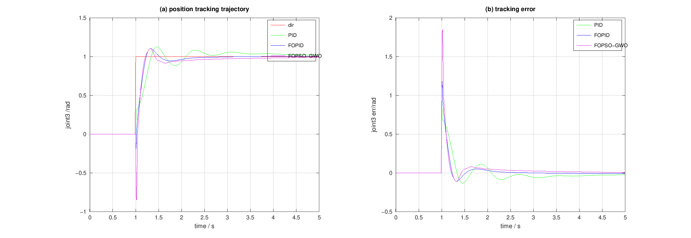
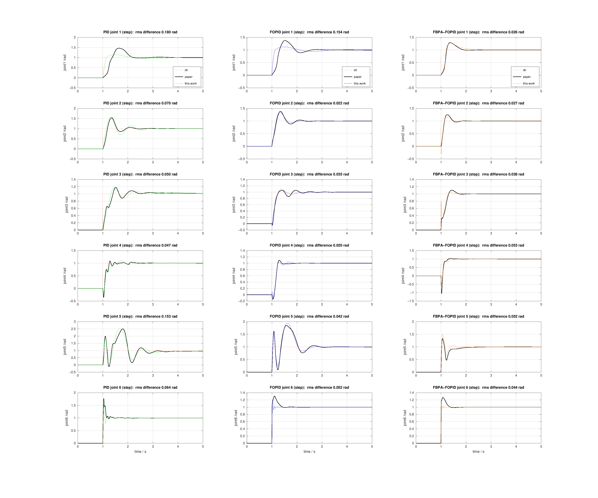
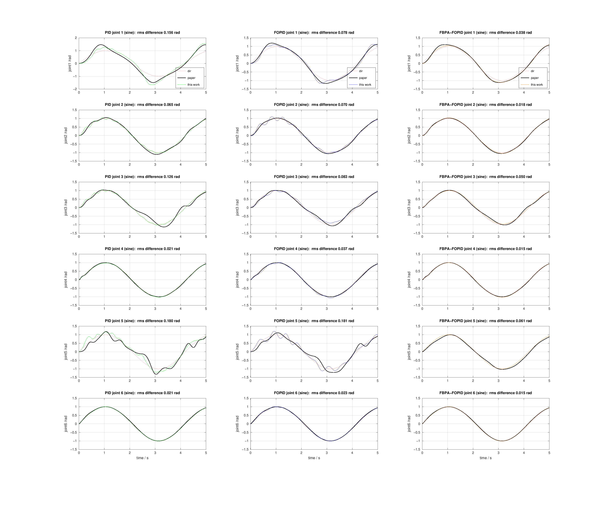
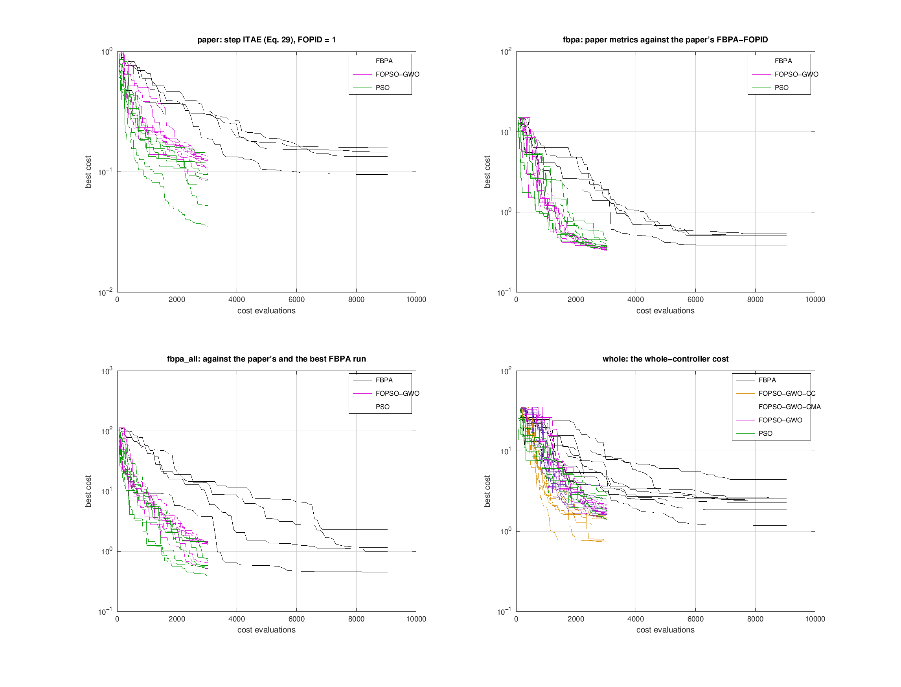
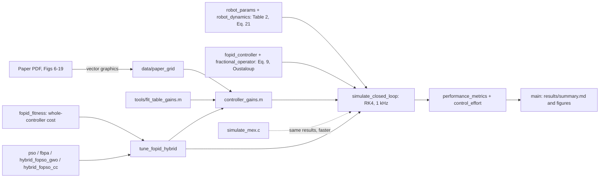

<div align="center">

# FOPSO-GWO-CC

### Cooperative-coevolution tuning of fractional-order PID control for a 6-DOF robotic arm

*Reproduction, audit and extension of* Jiang, Zhang & Liu, **"Trajectory tracking control of a
6-DOF robotic arm based on improved FOPID"**, *International Journal of Dynamics and Control*
13:137 (2025), DOI [10.1007/s40435-025-01620-x](https://doi.org/10.1007/s40435-025-01620-x)




<sub>Joint 3 step response of the six controllers, in the paper's Fig. 8 layout. The proposed
FOPSO-GWO-CC (amber) reaches a fast basin of joint 3 that the 30-dimensional swarms miss.</sub>

</div>

---

## At a glance

| | |
|---|---|
| **Problem** | Tune six independent FOPID controllers, 30 parameters, of a UR5-type 6-DOF arm for step and sine tracking |
| **Base paper's method** | FBPA (fractional-order PSO with beetle antennae search) on the step ITAE |
| **Proposed method** | **FOPSO-GWO-CC**: fractional-order PSO with grey-wolf leaders (FOPSO-GWO), then cooperative coevolution with one sub-swarm per joint |
| **Proposed objective** | A *whole-controller* cost: tracking against the paper's FBPA-FOPID, within the torque the paper's own controllers use on every joint |
| **Headline** | Better than the paper's FBPA-FOPID table on 4 of 5 metrics (equal peak time). Better than PSO-FOPID, tuned under identical conditions, on all 5 metrics. Beats PSO on **8 of 8** held-out seeds (p = 0.004) |
| **Reproduction** | PID / FOPID / FBPA-FOPID rebuilt from scratch. PID and FOPID gains fitted to the paper's Tables 3–4 come **within 7 %** of every table value |
| **Audit** | The base paper contradicts itself in four ways, including a torque table that is a permutation of its own figure ([`docs/audit_report.md`](docs/audit_report.md)) |

## Contents

1. [Contributions](#1-contributions)
2. [Quick start](#2-quick-start)
3. [The problem](#3-the-problem)
4. [The method](#4-the-method)
5. [Results: reproduction of the base paper](#5-results-reproduction-of-the-base-paper)
6. [Results: the proposed controller](#6-results-the-proposed-controller)
7. [Results: the optimisers under identical conditions](#7-results-the-optimisers-under-identical-conditions)
8. [What did not work](#8-what-did-not-work)
9. [Problems found in the base paper](#9-problems-found-in-the-base-paper)
10. [Limitations and future work](#10-limitations-and-future-work)
11. [Paper kit: where each table and figure comes from](#11-paper-kit-where-each-table-and-figure-comes-from)
12. [Code map](#12-code-map)
13. [Design decisions](#13-design-decisions)
14. [References](#14-references)

---

## 1. Contributions

1. **A complete, verified reproduction of the base paper.** The arm (its Table 2, UR5
   kinematics, Eq. 21), the six FOPIDs (Eq. 9), both experiments, the paper's metrics and its
   FBPA optimiser are all rebuilt from scratch. The paper publishes no gains, so the PID, FOPID
   and FBPA-FOPID gains were identified. Two identifications are provided:
   * fitted to the paper's own **curves**, read exactly from the PDF's vector graphics. These
     follow the published curves to 0.03–0.09 rad rms;
   * fitted to the paper's **tables**. Every Table 3–4 value of PID and FOPID comes within
     7 %, while the curves are kept as close as the table allows.
2. **An audit of the base paper.** Its joint-1 step and sine curves are physically
   incompatible. Its torque figures are numerical artefacts. Its torque table is a permutation
   of its own Fig. 19, and its tables disagree with its figures.
3. **A whole-controller objective.** It rewards tracking only within the torque the paper's
   own controllers use. It applies 24 per-joint caps, gives no credit beyond twice as good on
   any one metric, and includes a robustness check. Tracking alone would reward ever stiffer
   controllers.
4. **FOPSO-GWO-CC, the proposed optimiser.** FBPA's fractional-order velocity is kept, its
   beetle term (which has no effect at the paper's step size) is replaced by grey-wolf
   leaders, and the search finishes with **cooperative coevolution by joint**. This lets each
   joint leave the basin the 30-D swarm settled in.
5. **A fair, reproducible comparison.** PSO, FBPA, FOPSO-GWO, a CMA-ES hybrid and FOPSO-GWO-CC
   are compared with the same budget, search space, start controller, initial swarms and
   costs. Settings were chosen on development seeds and tested on held-out seeds. Negative
   results are kept.

---

## 2. Quick start

**Requirements:** MATLAB R2018a or newer (R2016b minimum), no toolboxes.

```bash
git clone --branch upcoming-risen https://github.com/stealth-raptor/errata-divergentia.git
cd errata-divergentia
```

In MATLAB, from that folder:

```matlab
addpath tools
verify_dynamics      % dynamics checks           -> "robot_dynamics: all checks passed"
main                 % every controller, curve-identified PID/FOPID/FBPA gains -> results/
main('table')        % PID and FOPID with the gains fitted to Tables 3-4       -> results/table_gains/
```

Or from a terminal (R2019a+): `matlab -batch "addpath tools; verify_dynamics; main"`.

Each run takes about 2 minutes without the compiled simulation. `main` rewrites
`results/summary.md` (every table) and the figures; `git checkout -- results` restores the
stored versions. The simulation is deterministic, so `git diff results/summary.md` should show
no changed number.

### One file per method

[`standalone/`](standalone/README.md) holds one self-contained file per method. Each carries
its own arm model, controller, simulation and metrics, and its own optimiser and cost where it
has one.

| File | Method |
|---|---|
| [`PID_conventional.m`](standalone/PID_conventional.m) | the conventional PID; `('table')` for the table-fitted gains |
| [`FOPID_conventional.m`](standalone/FOPID_conventional.m) | the paper's FOPID with fixed gains; `('table')` likewise |
| [`FBPA_FOPID.m`](standalone/FBPA_FOPID.m) | the paper's FBPA-FOPID: reproduction, and the FBPA optimiser |
| [`FOPSO_GWO.m`](standalone/FOPSO_GWO.m) | FOPSO-GWO, the first stage of the proposed method |
| [`FOPSO_GWO_CC.m`](standalone/FOPSO_GWO_CC.m) | **the proposed FOPSO-GWO-CC** |

### Re-running the optimisers (needs the compiled simulation)

```matlab
mex -setup C                % once; Windows: the free "MinGW-w64" add-on
build_mex                   % compiles simulate_mex.c (about 1000x faster than the .m loop)
check_mex                   % compiled == .m simulation
tune_fopid_hybrid(struct('Optimizer', 'FOPSO-GWO-CC', 'Fitness', 'whole', 'RandomSeed', 7, ...
                         'OutFile', fullfile('results', 'my_run.mat')))      % about 6 minutes
```

* **Use your own `OutFile`.** The default `OutFile` replaces the stored controller.
* **Expect a new sample, not the stored run.** The stored runs were made with a different
  random-number generator (GNU Octave's), so re-runs reproduce the statistics rather than
  the exact controllers.
* **To repeat the statistical comparison,** run
  `compare_weighted(1:8, {'PSO','FOPSO-GWO-CC'}, [1 1 1 1], 'my_runs')` (Sect. 7).

---

## 3. The problem

### The arm

A UR5-type 6-DOF manipulator with the paper's Table 2 masses, inertias and link lengths,
standard Denavit–Hartenberg kinematics, and the rigid-body dynamics of Eq. 21:

$$
M(q)\,\ddot q + C(q,\dot q)\,\dot q + G(q) + \tau_f(\dot q) = \tau .
$$

$M$, $C$ and $G$ come from the recursive Newton–Euler algorithm. They are checked against an
independent Jacobian formula for $M(q)$ to $10^{-15}$, and against energy conservation to
$10^{-14}$. As the paper's figures imply, $g = 0$ and $\tau_f = 0$ (D1).

### The controller

Six independent fractional-order PID controllers, one per joint (Eq. 9):

$$
u_j(t) = K_{p,j}\,e_j(t) + K_{i,j}\,D^{-\lambda_j} e_j(t) + K_{d,j}\,D^{\mu_j} e_j(t),
\qquad j = 1,\dots,6 .
$$

A PID is the special case $\lambda_j = \mu_j = 1$. The fractional operators $s^{\alpha}$ use
Oustaloup's approximation ($N = 5$, band $[10^{-3}, 10^{3}]$ rad/s, in parallel form,
discretised exactly at 1 kHz). Integer parts of the orders are an integrator or a backward
difference. 30 parameters are tuned: $(K_p, K_i, K_d, \lambda, \mu)$ for each of six joints.

### The two experiments and the paper's metrics

| Experiment | Reference | Metrics (mean over the six joints) |
|---|---|---|
| Step (Table 3, Figs 6–12) | 1 rad on every joint at $t = 1$ s | overshoot; adjustment time (last exit from a 5 % band); peak time, both from $t = 0$ |
| Sine (Table 4, Figs 13–19) | $\sin(1.5\,t)$ rad on every joint, 5 s | mean squared error; $\sum \lvert\tau\rvert$ |

The controller runs at 1 kHz and the plant is integrated with RK4 at 1 ms. All metrics are
taken on the paper's 0.01 s logging grid, which reproduces its MSE column from its own curves
to 0.7 %. The paper's fitness is the ITAE of the step (Eq. 29),
$\int_0^{5} t \sum_j \lvert e_j(t)\rvert \, dt$.

---

## 4. The method

### 4.1 The whole-controller cost

Tracking alone rewards ever stiffer controllers. An earlier run with no torque limit beat
every metric, but used about 8 times the paper's torque. The proposed cost scores what a real
controller must balance. $\rho_i$ is the ratio of metric $i$ to the paper's FBPA-FOPID: to
its table, or, for the two ITAEs, to its reproduction. Inside the cost, adjustment and peak
time are measured from the step.

$$
J = \frac{\sum_{i=1}^{6} w_i \max(\rho_i,\,0.5) + \sum_{k=1}^{4} \epsilon_k}{\sum_i w_i + 4}
\;+\; 2\sum_{i \in \text{paper}} \max(0,\ \rho_i - 1)
\;+\; 10 \sum_{\text{24 caps}} \max\!\Big(0,\ \frac{\text{peak}}{\text{cap}} - 1\Big)
\;+\; 10\,[\text{ill-conditioned}] .
$$

* **Tracking terms $\rho_{1..6}$:** step and sine ITAE, overshoot, adjustment time, peak
  time and sine MSE, with $w = (0.5, 0.5, 1, 1, 1, 1)$. The floor at 0.5 gives no credit for
  being more than twice as good on one metric.
* **Effort terms $\epsilon_k$:** $\sum\lvert\tau\rvert$ and the total variation of $\tau$ in
  both experiments, at 1 kHz with the 50 ms derivative kick left out, each relative to the
  reproduced FBPA-FOPID.
* **Regret:** an extra penalty on any of the paper's five metrics that is not better than
  its FBPA-FOPID table.
* **24 caps:** on every joint, the peak torque in the kick, in the rest of the step and in
  the sine run must stay within the largest that any of the paper's three controllers needs
  there. No joint may overshoot more than 33.1 %, the worst joint of the paper's FBPA-FOPID.
* **Robustness:** a candidate whose response moves by more than $10^{-6}$ rad when every
  gain changes by a relative $10^{-10}$ is ill-conditioned and penalised. Candidates that
  diverge are aborted.

### 4.2 FOPSO-GWO

FBPA's fractional-order velocity (Grünwald–Letnikov memory of the last four velocities,
Eq. 25) is kept. Its beetle-antennae term is replaced by a grey-wolf pull towards the three
best personal bests $\alpha, \beta, \delta$:

$$
\begin{aligned}
v^{k+1} ={}& (w - 1 + a)\,v^{k} + \tfrac{a(1-a)}{2}\,v^{k-1} + \tfrac{a(1-a)(2-a)}{6}\,v^{k-2}
           + \tfrac{a(1-a)(2-a)(3-a)}{24}\,v^{k-3} \\
          &+ c_1 r_1 (p - x) + c_2 r_2 (g - x) + c_3 r_3 (x_{\text{GWO}} - x), \\
x_{\text{GWO}} ={}& \tfrac{1}{3} \textstyle\sum_{L \in \{\alpha,\beta,\delta\}}
           \big(L - A \odot \lvert C \odot L - x \rvert\big), \qquad
A = 2a_g r - a_g,\quad C = 2r',\quad a_g = 2\,(1 - k/K)^2 .
\end{aligned}
$$

The settings, chosen on development seeds against plain PSO:
* $c_1 = c_2 = 1.5$, $c_3 = 1$: the three pulls add up to PSO's total of 4;
* fractional order $a = 0.9$, held. The paper's Eq. 27 lowers it to 0.4, which drains the
  velocity memory from 0.86 to 0.03;
* inertia $w$ falls from 0.9 to 0.4;
* $\lvert v\rvert \le 0.2$ of each range.

### 4.3 FOPSO-GWO-CC: cooperative coevolution by joint

Under the whole-controller cost, FOPSO-GWO alone beats PSO on 7 of 8 held-out seeds, but its
best run does not beat PSO's best (Sect. 11.1). The cost is close to a sum over joints, because
each joint's controller mostly shapes its own response. A swarm in all 30 dimensions settles in one basin for every joint at once. Joint 3,
for instance, has a fast-peaking basin that a 30-D swarm reaches only if the other 25 gains
happen to line up. Cooperative coevolution (Potter & De Jong 1994; van den Bergh & Engelbrecht
2004) searches each joint on its own:

```text
input : cost J, start controller z0, N = 30 particles, K = 100 iterations
1  run FOPSO-GWO on all 30 parameters for K1 = 0.3 K iterations         -> context x*
2  split the 30 particles into six sub-swarms S_1..S_6 of five, one per joint;
   S_j starts from joint j's gains in x* plus four random points of its 5-D box
3  for r = 1 .. K - K1
       for j = 1 .. 6
           move S_j by the FOPSO-GWO update in joint j's 5 gains
               (leaders from S_j; the global best is joint j's part of x*)
           evaluate each particle as J( x* with joint j's gains replaced )
           if the best of S_j improves J(x*), write it into x* at once
4  return x*
```

The population, budget (3030 evaluations), cost, start controller and initial swarm are the
same as for PSO. The 30 % swarm share was chosen on development seeds; 50 %, 30 % and 0 % all
beat PSO there.

### 4.4 A fair protocol

| | All optimisers |
|---|---|
| Budget | 30 particles × 100 iterations = 3030 evaluations (FBPA 9030: its antennae cost two more per particle) |
| Search space | all 30 parameters; log10 $K_p \in [-2,5]$, log10 $K_i \in [-4,5]$, log10 $K_d \in [-1,3]$, $\lambda,\mu \in [0.05,1.95]$ |
| Start | the identified FOPID, plus 30 % jittered copies, and the same random swarm for the same seed |
| Settings | standard or published coefficients; settings chosen on **development seeds 101–104** only |
| Test | **held-out seeds 1–8**; each reported controller is the best of 1–8 for every optimiser alike |

---

## 5. Results: reproduction of the base paper

### 5.1 Tables 3 and 4

Two identifications of the paper's PID and FOPID, against its Tables 3–4. Lower is better
for every metric.

| Controller | Gains | Overshoot (%) | Adjustment time (s) | Peak time (s) | Sine MSE (rad²) | Sine Σ\|τ\| (Nm) |
|---|---|---:|---:|---:|---:|---:|
| PID | **Paper** | 54.6 | 2.44 | 1.39 | 2.27e-2 | 3.74e4 |
| PID | Fitted to the tables | 51.1 *(−6.5 %)* | 2.49 *(+2.2 %)* | 1.45 *(+4.6 %)* | 2.12e-2 *(−6.5 %)* | 3.50e4 *(−6.5 %)* |
| PID | Fitted to the curves | 44.0 | 2.98 | 1.47 | 1.54e-2 | 1.05e4 |
| FOPID | **Paper** | 31.2 | 1.89 | 1.33 | 8.80e-3 | 2.57e4 |
| FOPID | Fitted to the tables | 29.2 *(−6.4 %)* | 1.95 *(+3.1 %)* | 1.35 *(+1.6 %)* | 8.29e-3 *(−5.8 %)* | 2.41e4 *(−6.1 %)* |
| FOPID | Fitted to the curves | 33.2 | 1.95 | 1.42 | 5.51e-3 | 1.03e4 |
| FBPA-FOPID | **Paper** | 22.1 | 1.43 | 1.09 | 3.70e-3 | 2.32e4 |
| FBPA-FOPID | Fitted to the curves | 19.8 | 1.45 | 1.25 | 2.25e-3 | 1.01e4 |

* **Fitted to the tables** (`main('table')`, `tools/fit_table_gains.m`): every table value is
  within 7 %. Among the gains that achieve this, the search keeps those closest to the
  published curves, and it rejects chattering or ill-conditioned loops.
* **Fitted to the curves** (`main`, the default): the gains that best follow the published
  curves.
* The paper's ranking, PID worse than FOPID worse than FBPA-FOPID, holds in both.
* The two cannot coincide, because the paper's tables disagree with its own figures (5.3).
  The torque column is the clearest case: matching it takes about 3.3 (PID) and 2.3 (FOPID)
  times the torque that the paper's curves need (Sect. 9).

### 5.2 Match to the published curves

Every curve of Figs 6–11 and 13–18 was read from the PDF's vector graphics. Black: the paper.
Colour: this work, with the gains fitted to the tables.

<p align="center">
  
  
</p>

Mean rms difference to the published curves (rad):

| Gains | PID step | PID sine | FOPID step | FOPID sine | FBPA-FOPID step | FBPA-FOPID sine |
|---|---:|---:|---:|---:|---:|---:|
| Fitted to the curves (`main`) | 0.092 | 0.080 | 0.058 | 0.051 | 0.040 | 0.033 |
| Fitted to the tables within 7 % (`main('table')`) | 0.094 | 0.095 | 0.054 | 0.079 | (as above) | (as above) |
| An earlier fit to the five table numbers only | 0.297 | 0.188 | 0.171 | 0.099 | – | – |

The coupled-arm features of the paper's figures are reproduced:
* joint 4's negative dip after the step;
* joint 3's early jump;
* joint 5's fast spike followed by a slow swing.

The curve-identified versions of these figures are `results/compare_step.png` and
`results/compare_sine.png`.

### 5.3 The paper's tables against its own figures

| Controller | Source | Overshoot (%) | Adjustment time (s) | Peak time (s) | Sine MSE (rad²) | Sine Σ\|τ\| (Nm) |
|---|---|---:|---:|---:|---:|---:|
| PID | Table | 54.6 | 2.44 | 1.39 | 2.27e-2 | 3.742e4 |
| PID | Figures | 59.1 | 2.32 | 1.44 | 2.26e-2 | 2.315e4 |
| FOPID | Table | 31.2 | 1.89 | 1.33 | 8.80e-3 | 2.569e4 |
| FOPID | Figures | 34.4 | 1.95 | 1.46 | 8.83e-3 | 3.741e4 |
| FBPA-FOPID | Table | 22.1 | 1.43 | 1.09 | 3.70e-3 | 2.315e4 |
| FBPA-FOPID | Figures | 21.2 | 1.52 | 1.26 | 3.68e-3 | 2.568e4 |

The MSE agrees to 1 %. The step metrics differ by up to 0.17 s and 4.5 points, and the torque
values match only after reassigning them to other controllers.

---

## 6. Results: the proposed controller

### 6.1 The paper's metrics

PSO-FOPID, FOPSO-GWO and FOPSO-GWO-CC were each tuned with the same whole-controller cost,
budget and starting swarms. Each is the best of held-out seeds 1–8.

| Metric | Paper FBPA-FOPID (table) | FBPA-FOPID (reproduced) | PSO-FOPID | FOPSO-GWO | **FOPSO-GWO-CC** | vs paper table | vs PSO-FOPID | vs PSO-FOPID, after the step |
|---|---:|---:|---:|---:|---:|---:|---:|---:|
| Overshoot (%) | 22.1 | 19.8 | 17.8 | 13.6 | **11.0** | **−50 %** | **−38 %** | |
| Adjustment time (s) | 1.43 | 1.45 | 1.33 | 1.35 | **1.24** | −14 % | −7 % | **−28 %** |
| Peak time (s) | 1.09 | 1.25 | 1.11 | 1.11 | **1.09** | ±0 % | −2 % | **−21 %** |
| Sine MSE (rad²) | 3.70e-3 | 2.25e-3 | 2.75e-3 | 1.88e-3 | **1.62e-3** | **−56 %** | **−41 %** | |
| Sine Σ\|τ\| (Nm) | 2.32e4 ¹ | 1.01e4 | 1.01e4 | 9610 | **9609** | (lower) ¹ | −5 % | |
| ITAE step / sine | n/a | 1.16 / 2.44 | 1.05 / 2.27 | 1.19 / 1.72 | **0.78 / 1.77** | n/a | −26 % / −22 % | |

<sub>¹ Not a fair comparison: the paper's torque values are not physically consistent
(Sect. 9).</sub>

* **Better than the paper's FBPA-FOPID table** on 4 of 5 metrics, and equal on peak time.
  It is better on all five against the paper's FBPA-FOPID curves and against this work's
  reproduction.
* **Better than PSO-FOPID on all five metrics and both ITAEs.** Times measured from $t = 0$,
  as the paper does, include the 1 s before the step. The last column measures them from the
  step.
* **All eight FOPSO-GWO-CC runs beat PSO-FOPID on four metrics**, not only the best one:

  | Metric | Range over the 8 runs |
  |---|---|
  | Overshoot | −25 to −42 % |
  | Adjustment time after the step | −3 to −38 % |
  | MSE | −28 to −69 % |
  | Torque | −1 to −8 % |
  | Peak time after the step | −22 to +6 % (the only metric that is not always better) |
* **The mechanism shows in the joints.** Joint 3 peaks at 1.01 s under FOPSO-GWO-CC, against
  1.24 s under FOPSO-GWO, while the other joints stay within 0.04 s of each other (the figure
  at the top).

### 6.2 Torque: within the paper's limits, near the physical floor

| Controller | Kick peak (Nm) | Step peak after kick (Nm) | Sine peak (Nm) | Sine Σ\|τ\| (Nm) | Sine total variation |
|---|---:|---:|---:|---:|---:|
| FBPA-FOPID (reproduced) | 8.17e4 | 1495 | 495 | 1.01e4 | 1445 |
| PSO-FOPID | 1.86e5 | 856 | 291 | 1.01e4 | 643 |
| **FOPSO-GWO-CC** | 1.05e5 | 1324 | 329 | 9609 | 598 |

* **All 24 per-joint caps are met.** The closest is at 87 %, and the derivative kick is
  44 % below PSO-FOPID's.
* **The torque saving is small for a physical reason.** Perfect tracking of the sine needs
  7395 Nm, computed by inverse dynamics: 699 Nm in the first 0.5 s and 6696 Nm after.
  * In steady tracking, FOPSO-GWO-CC halves PSO-FOPID's excess over the floor (551 against
    1071 Nm).
  * The initial catch-up costs every fast-tracking controller about the same.
* **Weighting the sine torque 3× in the cost does not change the ranking**
  (`tools/compare_weighted.m`, `results/torque_runs/`). FOPSO-GWO-CC still beats PSO on 8
  of 8 seeds (mean cost 0.954 against 2.391), and neither optimiser's mean torque falls
  (PSO 9934 → 9966 Nm, FOPSO-GWO-CC 9509 → 9554 Nm). There is little torque left to save.

---

## 7. Results: the optimisers under identical conditions

Final best cost over held-out seeds 1–8 (lower is better) under four costs:
* `paper`: the paper's step ITAE;
* `fbpa`: tracking against the paper's FBPA-FOPID;
* `fbpa_all`: the same, against the better of it and the FBPA re-run;
* `whole`: Sect. 4.1.

| Cost | PSO | FBPA | FOPSO-GWO | **FOPSO-GWO-CC** | CC beats PSO on | CC vs PSO, mean |
|---|---:|---:|---:|---:|---:|---:|
| whole | 2.181 | 2.462 | 1.764 | **1.162** | **8 of 8 seeds** | **−47 %** |
| fbpa | 0.388 | 0.486 | 0.352 | **0.257** | **8 of 8** | **−34 %** |
| fbpa_all | 0.785 | 1.224 | 1.193 | **0.615** | **6 of 8** | **−22 %** |
| paper | **0.088** | 0.134 | 0.116 | 0.093 | 4 of 8 | +5 % |

<sub>Means. FBPA ran on seeds 1–4 for the first three costs, and uses 9030 evaluations
against 3030 for the others.</sub>

<p align="center">
  
</p>

* **FOPSO-GWO-CC beats PSO under 3 of the 4 costs,** with the lowest best, median, mean and
  worst run in each. Under `whole`, its median run beats PSO's best, and winning 8 of 8 seeds
  gives a one-sided sign-test p of 0.004.
* **Under the paper's own fitness it is level with PSO.** The best runs there need joint 3's
  fast basin. FOPSO-GWO-CC finds it, while FOPSO-GWO, without coevolution, never does and
  loses 7 of 8.
* **Over all costs, CC ends lower than** PSO in 26 of 32 seed and cost pairs, FOPSO-GWO in
  29 of 32, and FBPA in 19 of 20.
* **The paper's FBPA is the weakest here, despite three times the evaluations:**
  * its beetle step (1e-4 of the range) moves a particle by about 1/1000 of a velocity;
  * its $\lvert v\rvert \le 1$ spans the whole box;
  * its Eq. 27 drains the fractional memory.

<details>
<summary><b>Full statistics: best, median, mean and worst per cost, and the CMA-ES hybrid</b></summary>

| Cost | Optimiser | best | median | mean | worst |
|---|---|---:|---:|---:|---:|
| paper | PSO | 0.035 | 0.089 | 0.088 | 0.144 |
| | FBPA | 0.095 | 0.140 | 0.134 | 0.159 |
| | FOPSO-GWO | 0.087 | 0.122 | 0.116 | 0.135 |
| | FOPSO-GWO-CC | 0.040 | 0.103 | 0.093 | 0.130 |
| fbpa | PSO | 0.341 | 0.379 | 0.388 | 0.444 |
| | FBPA | 0.386 | 0.512 | 0.486 | 0.534 |
| | FOPSO-GWO | 0.331 | 0.348 | 0.352 | 0.384 |
| | FOPSO-GWO-CC | 0.172 | 0.266 | 0.257 | 0.293 |
| fbpa_all | PSO | 0.389 | 0.643 | 0.785 | 1.396 |
| | FBPA | 0.449 | 1.072 | 1.224 | 2.302 |
| | FOPSO-GWO | 0.518 | 1.371 | 1.193 | 1.472 |
| | FOPSO-GWO-CC | 0.326 | 0.477 | 0.615 | 1.040 |
| whole | PSO | 1.378 | 2.223 | 2.181 | 2.983 |
| | FBPA | 1.186 | 2.412 | 2.462 | 4.418 |
| | FOPSO-GWO | 1.416 | 1.718 | 1.764 | 2.160 |
| | FOPSO-GWO-CMA | 1.610 | 1.881 | 2.106 | 3.646 |
| | FOPSO-GWO-CC | 0.734 | 1.286 | 1.162 | 1.554 |

Seeds won head to head (same cost and seed):

| Cost | CC vs PSO | CC vs FBPA | CC vs FOPSO-GWO | FOPSO-GWO vs PSO |
|---|---:|---:|---:|---:|
| paper | 4 of 8 | 3 of 4 | 5 of 8 | 1 of 8 |
| fbpa | 8 of 8 | 4 of 4 | 8 of 8 | 6 of 8 |
| fbpa_all | 6 of 8 | 4 of 4 | 8 of 8 | 2 of 8 |
| whole | 8 of 8 | 8 of 8 | 8 of 8 | 7 of 8 |

</details>

---

## 8. What did not work

These negative results are kept in `results/dev_runs/`, `results/ablation_runs/` and
`results/optimizer_runs/`.

| Attempt | Outcome |
|---|---|
| FOPSO-GWO's first settings ($c = 1/1/1$, order 0.9 → 0.4 as in the paper) | Lost to plain PSO on all three tracking costs (11 of 12 seed pairs). The swarm collapsed with $c = 1$ and was thrown about with $c = 2$ |
| CMA-ES refinement stage (FOPSO-GWO-CMA) | Won all 4 development seeds, but only 4 of 8 held-out seeds against PSO, and lost to plain FOPSO-GWO on 6 of 8: the shorter swarm cost more than the refinement gained |
| Joint-block crossover (a GA operator) | The joint structure is real: the best mix of two controllers scores 1.065 against 1.378 and 1.416. But inside one run the elite share a basin; development mean 1.965, worse than PSO |
| How far the cost can go | A long CMA-ES run from PSO-FOPID reaches 0.710 in 6000 evaluations. FOPSO-GWO-CC's best, 0.734 in 3030, comes close |

---

## 9. Problems found in the base paper

Details and evidence: [`docs/audit_report.md`](docs/audit_report.md).

1. **The joint-1 step and sine curves cannot both be correct.** By the angular-momentum
   balance about the base axis, no plant and controller pair produces both, whatever the
   link lengths, centre of mass or friction.
2. **The torque figures are numerical artefacts.** Fig. 12 has spikes of up to 1e9 Nm, and
   Figs 12 and 19 differ by 4–5 orders of magnitude.
3. **Table 4's torque column is a permutation of Fig. 19.** The curves labelled PID / FOPID /
   FBPA-FOPID sum to 2.315e4 / 3.741e4 / 2.568e4, which are the table's FBPA / PID / FOPID
   values.
4. **The tables disagree with the figures**, e.g. FBPA-FOPID peak time 1.09 s in the table
   against 1.26 s in the curves (Sect. 5.3).
5. **Eq. 23 prints the inertia weight as increasing**, $(w_{\max} - w_{\min})k/K$, while the
   text says it decreases.
6. **"Dimension 5" in the text, but 30 parameters are tuned.**
7. **Not published:** the gains, the solver, the fractional-operator settings, the centre of
   mass, the settling band and the friction coefficients.

---

## 10. Limitations and future work

| Limitation | Next step |
|---|---|
| 8 seeds per optimiser: enough for the main claim (8/8, p = 0.004), not for small differences | 20–30 seeds and a Wilcoxon signed-rank test |
| One plant: the paper's arm, without gravity or friction, with nominal parameters | ±10–20 % parameter errors, gravity, friction, sensor noise, other trajectories |
| One problem for the optimiser | A standard benchmark suite (e.g. CEC) and other near-separable control problems |
| The proposed controller is tuned with this work's cost; under the paper's ITAE it is level with PSO | Multi-objective tuning (a Pareto front of tracking against torque) |
| The identified gains are not unique: they show the curves are attainable, not that they are the authors' gains | — |
| Times are measured from $t = 0$, as in the paper; from the step the improvements are 3–10 times larger | Report both conventions |

---

## 11. Paper kit: where each table and figure comes from

Every number above is regenerated by one command and stored in `results/`.

| Paper item | Command | File |
|---|---|---|
| Reproduction against Tables 3–4, table-fitted gains | `main('table')` | `results/table_gains/summary.md` Sect. 1 |
| Reproduction against Tables 3–4, curve-identified gains | `main` | `results/summary.md` Sect. 1 |
| Published against reproduced curves | `main('table')` / `main` | `results/table_gains/compare_*.png`, `results/compare_*.png` |
| Joint responses of all controllers (Figs 6–19 layout) | `main` | `results/fig06_joint1_step.png` … `fig19_sine_torque.png` |
| Proposed controller against the baselines | `main` | `results/summary.md` Sect. 2 |
| Torque, kick and the 24 caps | `main` | `results/summary.md` Sect. 3 |
| Optimiser statistics, head-to-head, dev-seed selection | `main` (reads the stored runs) | `results/summary.md` Sect. 4 |
| Convergence | `main` | `results/convergence.png` |
| Per-joint metrics and all gains | `main` | `results/summary.md` Sects. 5 and 8 |
| The paper's tables against its figures | `main` | `results/summary.md` Sect. 7 |
| Audit of the paper | — | `docs/audit_report.md` |
| Re-running the comparison | `tools/compare_optimizers.m`, `tools/compare_weighted.m` | `results/optimizer_runs/`, `results/torque_runs/` |
| Re-running the settings selection | `tools/develop_fopso_gwo.m`, `tools/ablate_optimizers.m` | `results/dev_runs/`, `results/ablation_runs/` |

**Figure consistency.** The figures in `results/` use the curve-identified PID and FOPID; those
in `results/table_gains/` use the table-fitted ones. Use one set throughout the paper.

### 11.1 A paper on FOPSO-GWO alone

FOPSO-GWO without coevolution is a weaker result than FOPSO-GWO-CC. These are its numbers,
for a paper that reports it alone: the best of seeds 1–8 (seed 6), and `whole` cost
throughout unless stated otherwise.

**The controller, against the three references** (change in %; negative is better):

| Reference | Overshoot | Adjustment time | Peak time | Sine MSE | Sine Σ\|τ\| | ITAE step / sine |
|---|---:|---:|---:|---:|---:|---:|
| Paper's FBPA-FOPID table | −38.5 | −5.4 | **+2.0** | −49.3 | (lower) | n/a |
| FBPA-FOPID reproduced | −31.3 | −6.9 | −11.0 | −16.6 | −5.2 | n/a |
| PSO-FOPID | −23.6 | **+1.8** | −0.1 | −31.7 | −5.1 | **+13.5** / −24.4 |

* It is better than the reproduced FBPA-FOPID on all five metrics, and better than the
  paper's table on four, all but peak time.
* Against PSO-FOPID it is better on overshoot, MSE and torque, but not on adjustment time
  (+7.3 % measured from the step) or the step ITAE.

**The optimiser, against PSO and FBPA** (same budget, swarm and cost; FBPA with three times
the evaluations):

| Cost | vs PSO: mean | vs PSO: seeds won | vs FBPA: mean | vs FBPA: seeds won |
|---|---:|---:|---:|---:|
| whole | **−19.1 %** | **7 of 8** (sign test p = 0.035) | **−28.4 %** | 6 of 8 |
| fbpa | −9.3 % | 6 of 8 | −27.6 % | 4 of 4 |
| paper | +32.1 % | 1 of 8 | −13.3 % | 3 of 4 |
| fbpa_all | +51.9 % | 2 of 8 | −2.5 % | 1 of 4 |

* **What the evidence supports:** FOPSO-GWO beats the paper's FBPA in mean under every
  cost (14 of 20 seed pairs). Under the whole-controller cost it also beats plain PSO in
  mean, median and worst run, on 7 of 8 seeds.
* **Its limits:**
  * its best run is 2.7 % above PSO's best (1.416 against 1.378);
  * under the paper's ITAE and `fbpa_all` it loses to PSO.

  The coevolution stage of FOPSO-GWO-CC is what closes these gaps (Sect. 4.3).

---

## 12. Code map



| Path | Contents |
|---|---|
| `main.m` | runs every controller through both experiments; writes `results/` |
| `robot_params.m`, `robot_dynamics.m` | the arm (Table 2, UR5 DH) and its dynamics (Eq. 21, recursive Newton–Euler) |
| `fopid_controller.m`, `fopid_update.m`, `fractional_operator.m` | the FOPID (Eq. 9) and the Oustaloup operator |
| `simulate_closed_loop.m`, `simulate_mex.c`, `build_mex.m` | the closed loop at 1 kHz, in MATLAB and in C |
| `performance_metrics.m`, `control_effort.m` | Tables 3–4 metrics and ITAE; torque peaks, sums, total variation |
| `controller_gains.m` | every gain set: curve-identified, table-fitted, tuned |
| `tune_fopid_hybrid.m`, `fopid_fitness.m` | the tuning driver and its costs |
| `hybrid_fopso_cc.m` | **FOPSO-GWO-CC (proposed)** |
| `hybrid_fopso_gwo.m`, `pso.m`, `fbpa.m`, `hybrid_fopso_cma.m`, `cmaes.m` | FOPSO-GWO, the baselines and the CMA-ES variants |
| `paper_curves.m`, `plot_paper_figures.m`, `plot_convergence.m` | the paper's curves and the figures |
| `tools/` | dynamics and MEX checks, the optimiser comparisons, the table fit |
| `standalone/` | one self-contained file per method |
| `data/paper_grid/` | the paper's curves on its 0.01 s grid |
| `results/` | every stored output: summaries, figures, gains, 300+ optimiser runs |
| `docs/audit_report.md` | the audit of the base paper |

---

## 13. Design decisions

<details>
<summary><b>D1–D14: what was chosen, why, and the evidence</b></summary>

| # | Decision | Reason / evidence |
|---|---|---|
| D1 | Plant: Table 2 as printed, UR5 standard DH, COM at the DH frame origins, $g = 0$, no friction | The published responses are flat before the step (< 1e-4 rad); with gravity, joints 2, 3 and 5 would sag 0.14–0.16 rad. The COM alternatives fit no better (audit 4.2). Eq. 21 has friction but no coefficients |
| D2 | Recursive Newton–Euler, seven recursions batched | Same M, C, G as the paper's Lagrange form; checked against a Jacobian M(q) to 1e-15 and energy conservation to 1e-14 |
| D3 | Oustaloup, N = 5, [1e-3, 1e3] rad/s, parallel form, exact ZOH at 1 kHz | The FOMCON defaults; the paper gives no settings |
| D4 | RK4 at 1 ms, controller at 1 kHz, logging every 0.01 s | The 0.01 s logging was read from the paper's figures; on that grid its MSE column is matched to 0.7 % |
| D5 | Metrics: 5 % band; times from $t = 0$ | The 5 % band best reproduces Table 3 from the paper's own curves (audit 3.5) |
| D6 | Gains identified from the curves (per experiment; `main('shared')`: one set for both), or fitted to the tables within 7 % (`main('table')`) | The paper publishes no gains, and an earlier fit to five averaged numbers left the curves unconstrained (0.30 rad rms off) |
| D7 | Whole-controller cost (Sect. 4.1) | Tracking alone gave about 8× the paper's torque after the step |
| D8 | All 30 parameters at once, log-scale gains, start from the identified FOPID | The joints are coupled; the start guarantees a result no worse than the FOPID |
| D9 | Same budget, space, start, swarm and cost for every optimiser | Only the algorithm differs |
| D10 | Settings chosen on seeds 101–104, tested on 1–8, with selection rules fixed in advance | No tuning to the test seeds; every candidate kept |
| D11 | FOPSO-GWO: $c = 1.5/1.5/1$, order held at 0.9 | Chosen from 13 candidates on the development seeds: −18.6 % (paper cost) and −9.4 % (fbpa) against PSO. The first settings, with the paper's order schedule, lost to PSO (Sect. 8) |
| D12 | FOPSO-GWO-CC: 30 % swarm, then six sub-swarms of five | Development: 1.243 against PSO's 1.767; all three shares beat PSO on 4 of 4 seeds |
| D13 | Compiled simulation (C99, fixed-size arrays) | 40 s → 0.03 s per simulation; equal to the .m loop to round-off (1e-14 rad, 6e-9 on the worst-conditioned set) |
| D14 | MATLAB, no toolboxes; MAT v7; `readmatrix` with a `dlmread` fallback | Runs on R2016b+; checked in R2024b, where `main` reproduces every stored number |

</details>

---

## 14. References

* Z. Jiang, X. Zhang, G. Liu, "Trajectory tracking control of a 6-DOF robotic arm based on
  improved FOPID," *Int. J. Dyn. Control* 13:137, 2025. (the base paper)
* M. A. Potter, K. A. De Jong, "A cooperative coevolutionary approach to function
  optimization," *PPSN III*, LNCS 866, 1994.
* F. van den Bergh, A. P. Engelbrecht, "A cooperative approach to particle swarm
  optimization," *IEEE Trans. Evol. Comput.* 8(3), 2004.
* S. Mirjalili, S. M. Mirjalili, A. Lewis, "Grey wolf optimizer," *Adv. Eng. Softw.* 69, 2014.
* E. J. S. Pires, J. A. T. Machado, P. B. de Moura Oliveira, J. B. Cunha, L. Mendes,
  "Particle swarm optimization with fractional-order velocity," *Nonlinear Dyn.* 61, 2010.
* J. Kennedy, R. Eberhart, "Particle swarm optimization," *Proc. ICNN*, 1995;
  Y. Shi, R. Eberhart, "A modified particle swarm optimizer," *Proc. IEEE ICEC*, 1998.
* X. Jiang, S. Li, "BAS: Beetle antennae search algorithm for optimization problems,"
  arXiv:1710.10724, 2017.
* A. Oustaloup, F. Levron, B. Mathieu, F. M. Nanot, "Frequency-band complex noninteger
  differentiator: characterization and synthesis," *IEEE Trans. Circuits Syst. I* 47(1), 2000.
* N. Hansen, "The CMA evolution strategy: a tutorial," arXiv:1604.00772, 2016.

<sub>Check every reference against the publisher's record before submission.</sub>

<div align="center">

---

<sub>Every number in this document is generated by the code in this repository and stored in
`results/`. All 34 `.m` files pass the MATLAB code analyser (MISS_HIT), and the C source
compiles as strict C99.</sub>

</div>
